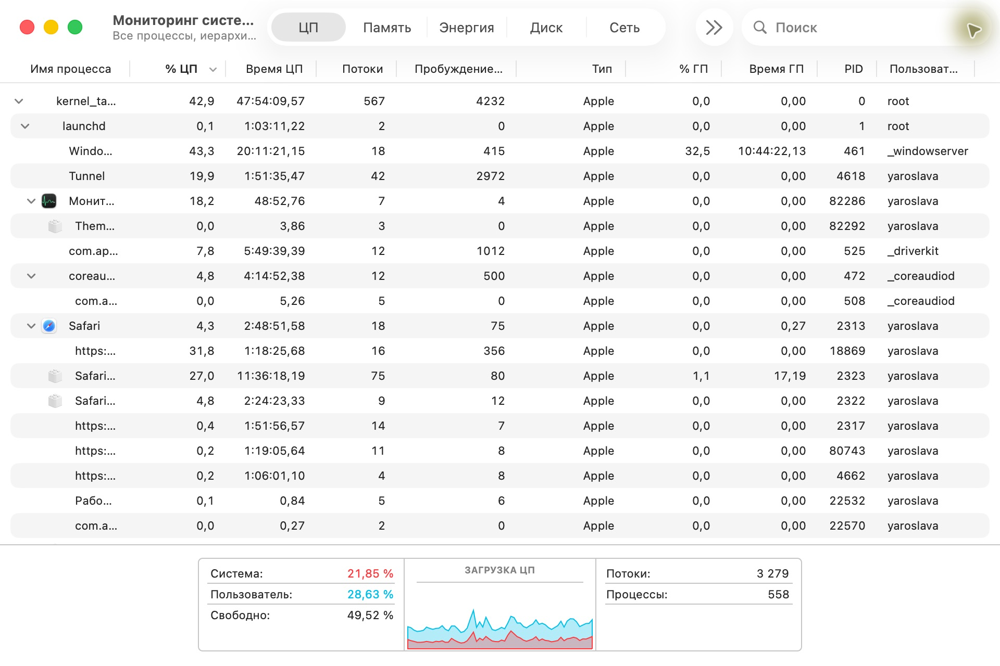
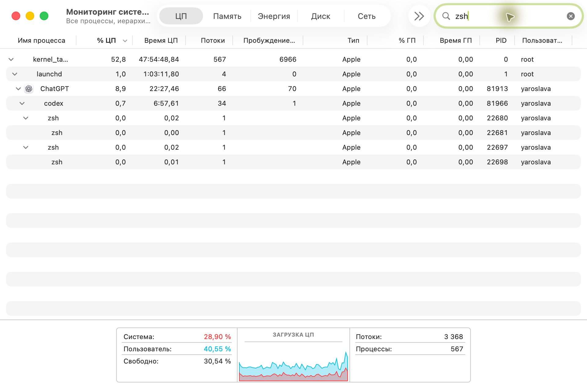
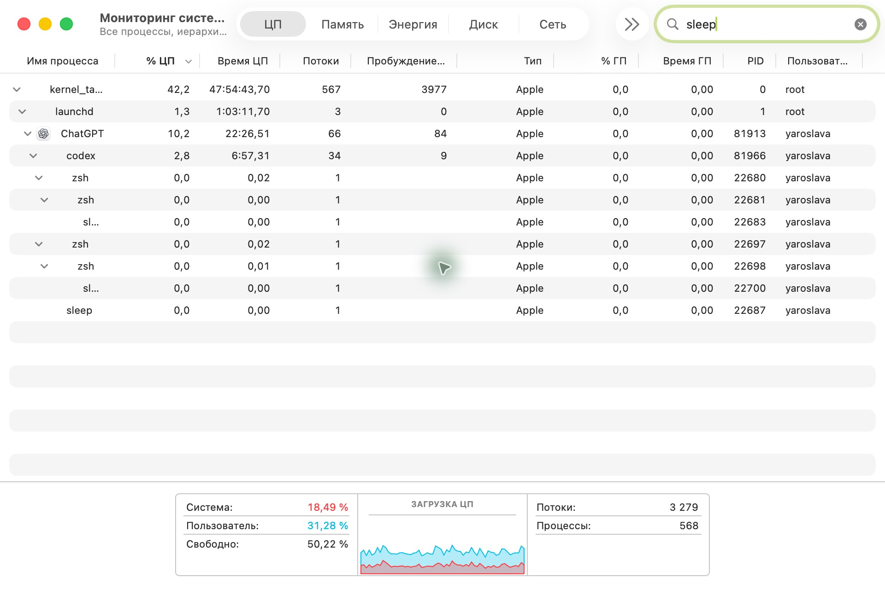
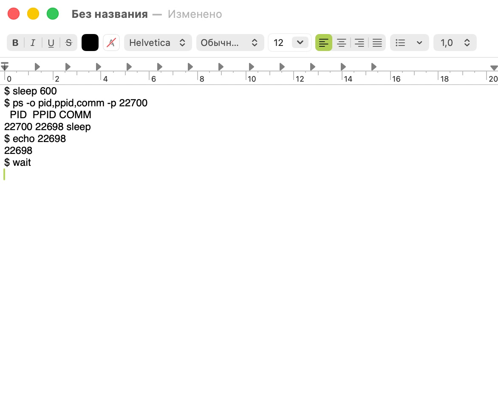
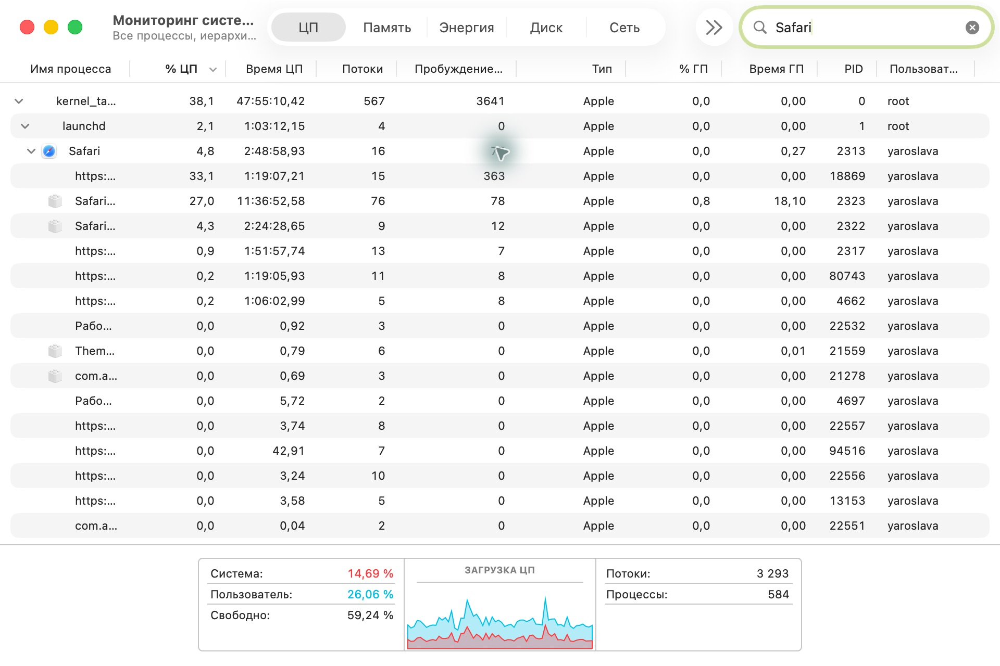
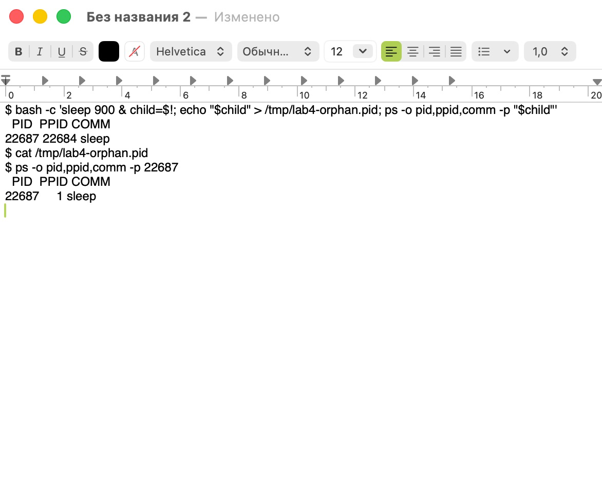

# ЛР 4. Дерево процессов

Система: macOS 26.6.2.

## Дерево

Процесс в начале дерева и его номер: `kernel_task` (0). Под ним в дереве виден `launchd` (1).

Цепочка родителей оболочки, в которой выполнен опыт: `launchd` (1) → ChatGPT (81913) → `codex` (81966) → `zsh` (22697) → `zsh` (22698).

Дочерний процесс: `sleep` (22700), родитель — `zsh` (22698).

Команда, которой проверен родитель: `ps -o pid,ppid,comm -p $!` показала PPID 22698. Команда `echo $$` вывела тот же номер. В дереве `sleep` находился под этой оболочкой.

Процессов у браузера и имя процесса вкладок: на раскрытой ветке Safari видно пять процессов. Три строки с адресами сайтов обозначают процессы веб-контента WebKit. Ещё две строки — Safari Graphics and Media и Safari Networking.

## Процесс после завершения родителя

Номер процесса: `sleep` (22687).

Номер родителя до и после завершения настоящего родителя: сначала 22684 (`bash`), затем 1 (`launchd`). PID самого `sleep` остался прежним.

Положение процесса в дереве после завершения родителя: непосредственно под `launchd`, отдельно от ветки оболочки.

Не получилось: управление приложением «Терминал» было недоступно. Команды выполнены в оболочке Codex. На снимках 04 и 06 показан фактический вывод команд, открытый в TextEdit.

## Снимки экрана

